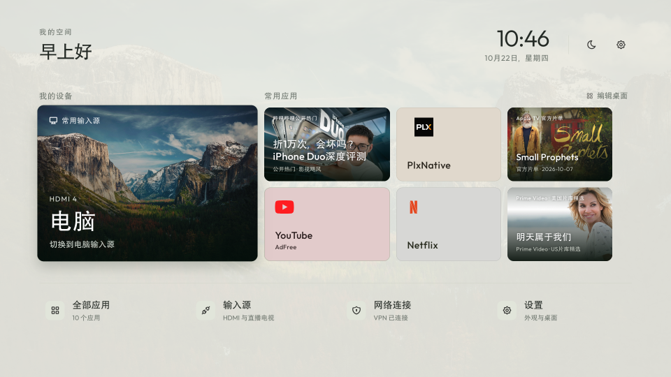

# LG webOS desktop

[简体中文](README.md) | **English**

A tile launcher for rooted LG webOS TVs. It intercepts the remote Home button and restores the launcher or previous HDMI input after waking from standby. It runs on the TV without keeping a computer on.

The project is built on [webos-vibehack](https://github.com/OmkarK97/webos-vibehack), adding Chinese font fallbacks, a TV-side Home helper, and standby state recovery. The current source and tested TV installation are version **1.3.0**. The TV interface is in Chinese; this page provides English documentation.

## Interface comparison

The screenshots below were captured from the same LG C5 (stock home on October 21, 2026; custom desktop version 1.3.0 on October 22, 2026). Open either image for full resolution.

| LG stock home | Custom desktop (1.3.0) |
|---|---|
| [](docs/images/lg-home.png) | [](docs/images/tile-home-1.3.0.png) |

### Key features

- **Layout**: HDMI shortcuts on the left; two continuous rows of app tiles on the right with horizontal scrolling for additional apps; bottom drawer for all apps, inputs, VPN, and settings.
- **Palette and icons**: Colors extracted automatically from app icons to generate light and dark palettes; neutral fallback when an icon color cannot be read. Wallpaper options include valley, misty mountains, and solid backgrounds.
- **Automatic theme**: Switches by local TV time (light from 07:00 to 19:00, dark otherwise), or lockable to either theme in settings.
- **Display and protection**: Uses UTF-8 with LG Chinese font fallback; localized dates, greetings, and menus; dims automatically after three minutes of inactivity without altering the TV native OLED protection settings.

Screenshots show static layout only. See the [verification record (in Chinese)](docs/verification.md) for physical testing of button interception and standby recovery.

## Home button and standby behavior

| Action | Result |
|---|---|
| Short press Home button | Open the custom desktop |
| Hold Home button for ~1 second, then release | Open LG stock home |
| Wake from standby after using desktop | Restore custom desktop |
| Wake from standby after using HDMI | Let LG restore the last HDMI input |
| Exit an app opened from custom desktop | Return to custom desktop (tested with Bilibili) |
| Exit an app opened from LG stock home | Preserve LG native return behavior |
| Disable integration | Remove custom autostart hooks and input lease; keep root and installed apps |

Back-button behavior inside third-party apps depends on each app. YouTube AdFree and Alcyone do not show an exit confirmation prompt at the top level; press Home to return to the desktop. Leaving the VPN screen does not disconnect the background VPN tunnel.

## App management

Manage apps on the TV without editing code:

1. **Add or remove tiles**: Select **编辑桌面** at the top right and press confirm to toggle app tiles on the home screen. Hiding a tile does not uninstall the app; the bottom **全部应用** list retains all installed apps.
2. **Reorder tiles**: Long-press confirm on an app tile for 0.6 seconds (or choose "调整首页顺序" in the edit panel), navigate with arrow buttons, press confirm to save, or Back to cancel.
3. **Refresh list**: Reopen the desktop after installing a new app, or refresh manually in the app drawer.

Tile order, selections, wallpaper, and theme settings are saved locally on the TV. Upgrading automatically imports existing preferences. If loading fails, cached entries are preserved; save errors do not erase existing selections.

## Compatibility and known limitations

- **Tested hardware**: LG OLED42C5XCA running webOS SDK 11.2.0 and firmware 43.21.73.
- **Architecture**: While the Linux kernel is aarch64, input interception and user-space dependencies run in an ARM32 environment. Do not use aarch64 native binaries.
- **Prerequisites**: TV must be rooted with Homebrew Channel installed and SSH key login configured. This repository does not provide root exploit tools or unverified third-party binaries.
- **Known limitations**:
  - Holding Home for longer than 6 seconds is not yet intercepted.
  - The TV-side button helper currently lacks a supervisor process for auto-restart on crash.
  - Playback position inside third-party streaming apps is not restored.
  - Standby recovery has been physically verified; complete cold-boot acceptance has not yet been logged.

## Documentation index

The guides below are currently written in Chinese:

- [Installation and deployment](docs/install.md): Sync apps, prepare native binaries, package, install, and disable.
- [Architecture and recovery](docs/architecture.md): Module boundaries, state flow, and failure recovery.
- [Native dependencies and checksums](docs/native.md): Pinned versions, checksums, and build steps.
- [Streaming catalog configuration](docs/streaming-catalog.md): TMDB API setup, platform mapping, and artwork.
- [Verification scope](docs/verification.md): Physical test records versus automated local checks.
- [Project history and decisions](docs/project-record.md): Problem analysis, design evolution, and review boundaries.
- [Changelog](CHANGELOG.md).

## Dynamic content sources

Tiles fetch content asynchronously on the TV from public endpoints, without accessing personal accounts or watch histories:

| Tile | Data source | Notes |
|---|---|---|
| Bilibili | [Bilibili public popular list](https://www.bilibili.com/v/popular/all) | Public ranking; no personal recommendations |
| YouTube | [NASA official channel](https://www.youtube.com/@NASA) public RSS | Public video updates and thumbnails |
| Netflix | [Netflix Tudum Top 10](https://www.netflix.com/tudum/top10) | English TV series weekly top 10; covers via [TVmaze](https://www.tvmaze.com/api) |
| Apple TV | [Apple TV Press](https://www.apple.com/tv-pr/originals/) | Official public original lineup |
| Prime Video / Disney+ / HBO Max | [TMDB API](https://www.themoviedb.org/) + JustWatch | Public catalog selection filtered for the US region |

TMDB tiles display catalog selections, not official platform popularity ranks, personal watch progress, or newly added release dates. Prime Video covers have been verified on the test TV. Disney+ and HBO Max queries have been verified, but their apps have not yet undergone playback acceptance testing. Content and trademarks belong to their respective owners.

> This product uses the TMDB API but is not endorsed or certified by TMDB. Streaming availability data is provided by JustWatch via TMDB.

## Local development and checks

Local testing requires Node.js 22 and Python 3.12. It does not connect to the TV:

```sh
node --test tests/*.cjs
python3 -m compileall -q tools scripts
bash -n scripts/build.sh service/autostart.sh
```

### TV configuration and app list

- `app/apps.example.js` provides a placeholder with the LG stock home. Before first deployment, sync the real app list and icons from your TV using the sync script. Do not treat the example file as a live inventory.
- The `computerInput` field in `app/config.js` sets the left-side HDMI shortcut (e.g. `com.webos.app.hdmi4`).

## Upstream projects and credits

The table separates source code, external dependencies, design references, and independently installed TV apps. Root tools and independent apps are not distributed in this repository:

| Project | Role in this repository |
|---|---|
| [OmkarK97/webos-vibehack](https://github.com/OmkarK97/webos-vibehack) | Frontend base, retaining its upstream MIT notice; design derived from tv-vibehack |
| [Gathin23/tv-vibehack](https://github.com/Gathin23/tv-vibehack) | Original layout and icon reference credited by webos-vibehack |
| [angelcode1/webos-HomeBack](https://github.com/angelcode1/webos-HomeBack) | Home-key IPC protocol and native build reference |
| [sundermann/inputhookpp](https://github.com/sundermann/inputhookpp) | External native input hook, GPL-3.0 license |
| [smx-smx/ezinject](https://github.com/smx-smx/ezinject) | External native injection utility, governed by its own COPYING license |
| [nthnclrk/CleanFrame](https://github.com/nthnclrk/CleanFrame) | Layout reference for device and app sections, wallpaper, and icon sources |
| [simple-icons/simple-icons](https://github.com/simple-icons/simple-icons) | Brand icon assets, CC0 license; trademarks belong to respective owners |
| [tabler/tabler-icons](https://github.com/tabler/tabler-icons) | Functional line icons, MIT license |
| [Outfitio/Outfit-Fonts](https://github.com/Outfitio/Outfit-Fonts) | Outfit font, SIL OFL 1.1 license |
| [throwaway96/slopbro](https://github.com/throwaway96/slopbro) | Tool used to root the test TV; root workflows are outside this repo |
| [webosbrew/webos-homebrew-channel](https://github.com/webosbrew/webos-homebrew-channel) | TV-side homebrew manager and elevated service layer |
| [webosbrew/youtube-webos](https://github.com/webosbrew/youtube-webos) | Separately installed YouTube AdFree app launched by the desktop |
| [ichikanya/Alcyone](https://github.com/ichikanya/Alcyone) | Separately installed VPN client; desktop shows connection status and launcher shortcut |

Exploration references included [Gathin23/cleanyourtv](https://github.com/Gathin23/cleanyourtv). Alternative Home hook research evaluated [Simon34545/lginputhook](https://github.com/Simon34545/lginputhook) and [zzeppieri/webos-custom-home](https://github.com/zzeppieri/webos-custom-home), neither of which is bundled. Dynamic tile concepts were inspired by Jakub Kralka layout showcase (https://x.com/jakubkralka/status/2112548525577785621) and motion demo (https://x.com/jakubkralka/status/2112629158547423480).

Pinned native versions and checksums are in [native dependencies](docs/native.md). Photography credits and asset licenses are recorded in [asset records](app/ASSETS.md).

## License

New code and frontend modifications are licensed under MIT. Upstream copyright notices are preserved in [LICENSE](LICENSE) and [original license notices](licenses/webos-vibehack-MIT.txt). The Outfit font in `app/fonts/` is licensed under SIL OFL 1.1.

Native components `inputhookpp` and `ezinject` are independent external dependencies governed by their respective licenses; they are not covered by MIT. See [native dependencies](docs/native.md). This project is not affiliated with LG. Rooting may void warranties or be irreversible.
