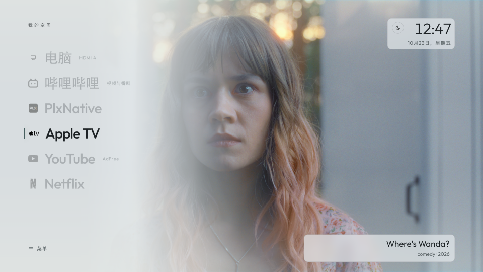
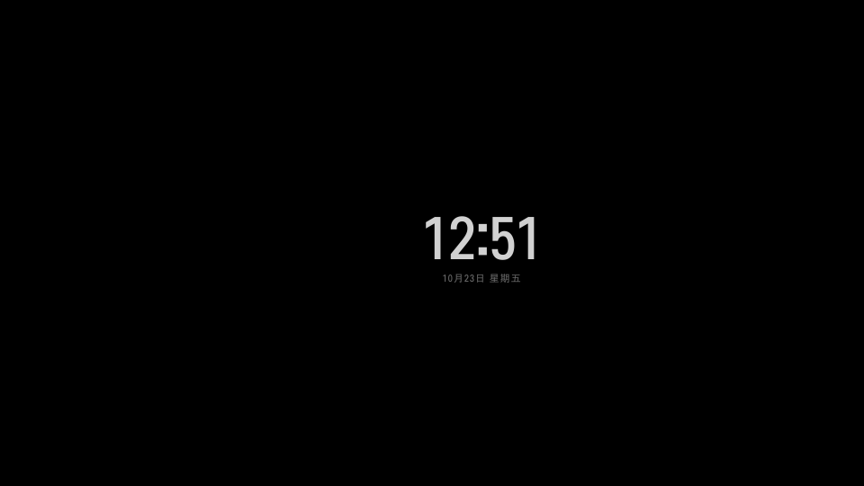

# LG webOS poster-list desktop

[简体中文](README.md) | **English**

A poster-list Chinese launcher for rooted LG webOS TVs. It bind-mounts the launcher as the system Home, so app exits, a short Home press, and boot go straight to it without flashing LG's stock Home. It also restores the launcher or the last HDMI input after waking from standby. The launcher runs on the TV, so no computer has to stay on.

It starts from [webos-vibehack](https://github.com/OmkarK97/webos-vibehack), with Chinese font fallback, a TV-side button helper, the poster-list home, the system-home mount, a system screen-saver replacement, and shared launcher state added here. Current source and tested version: **1.5.5**. The interface is in Chinese; this page is the English documentation.

## Install

The TV must be rooted, with Homebrew Channel installed and SSH key login configured. This repository does not provide root tools or third-party binaries. Follow [installation and deployment](docs/install.md) to sync apps, prepare native dependencies, and package the launcher. Disabling works from the same page.

A rooted TV installs over **root SSH on port 22**, not the webOS Developer Mode port 9922. The installer mounts the launcher as the system Home, mounts the standalone screen saver over LG's screen-saver app, and syncs the launcher state into the Home copy. A short Home press or an app exit lands directly on the desktop.

To restore LG stock Home and the stock screen saver temporarily, run `tools/desktop_mode.py off`; run `on` to re-enable. To restore only the stock screen saver, run `tools/screensaver_mode.py off`. Disabling removes only the mounts and startup hooks; apps and root stay installed. System profiling and reversible debloating are supported via `tools/profile.py` and `tools/debloat.py`.

## Interface

| LG stock home | Custom desktop | Screen saver |
|---|---|---|
| [](docs/images/lg-home.png) | [](docs/images/poster-home-1.5.3.png) | [](docs/images/screensaver-1.5.3.png) |

The left side is a vertical list of the computer input and favourite apps. The focused app gets a dynamic cover:

- Landscape covers run full-bleed. Portrait covers sit in a card at about 80% height on the right, over a blurred and darkened copy of the same image.
- Covers crossfade with two layers. They do not slide sideways or stack when switching quickly.
- The bottom-right caption shows the current title and a one-line description, with Chinese preferred.
- The three-line menu at the bottom left holds all apps, inputs, network, and settings.
- Themes are auto, dark, light, and Pure OLED Black. In light mode the clock and caption use a translucent paper surface.
- Wallpapers are a valley, misty mountains, or a solid color. The theme switches on local TV time at 07:00 and 19:00, or can be locked in settings.

Settings are grouped into **Appearance**, **Desktop**, and **System**. Appearance holds theme, wallpaper, Pure OLED Black, and input labels; Desktop holds home apps and content sources; System opens LG settings. Theme, wallpaper, home apps, order, and HDMI labels are stored on the TV; the normal app and the system-home copy share them through a TV-side state file.

Input labels assign HDMI 1–4 to Default, PC, PS5, PS4, Xbox, Switch, or Media Center; the home computer entry shows the matching name and color mark.

The screen saver is no longer an in-app overlay. It bind-mounts over LG's `com.webos.app.screensaver` just like the system Home: after three idle minutes the system starts a pure-black floating clock, shifts it slightly about every 25 seconds, and dismisses it on any key. This prevents the stock screen saver from covering the custom one.

Short Back stays with the app. When an app consumes Back and will not exit, holding Back for about 0.7 seconds returns to the desktop without breaking short in-app navigation.

The screenshots show layout only. System Home, the screen saver, the cold-stone light palette, button interception, and standby recovery results are in the [verification record](docs/verification.md).

## Home button and standby behavior

| Action | Result |
|---|---|
| Short press Home | Open the system-home custom desktop |
| Hold Home | Use the system Home long-press path; while enabled, the stock LG Home is masked by the mount |
| Shut down from the desktop, then power on (wake from standby) | Restore the custom desktop |
| Shut down from HDMI, then power on | LG keeps the last input |
| Exit an app launched from the desktop | Return directly to the custom desktop, without a stock-Home frame |
| Back does not exit inside an app | Hold Back for about 0.7 seconds to return to the custom desktop |
| Short Back inside an app | Keep the app's own back navigation |
| Disable the desktop (`desktop_mode.py off`) | Unmount the system Home and restore LG stock Home |

Bilibili shows its own exit confirmation; confirming it returns directly to the custom desktop. YouTube AdFree and Alcyone consume short Back at the top level, so use long Back or Home to leave. Leaving the Alcyone screen does not disconnect the VPN tunnel.

## Manage apps

1. Add or remove apps: open **All apps** from the menu, choose **Edit desktop**, then toggle apps. Hiding affects the home screen only; the all-apps list stays complete.
2. Reorder: in **Edit desktop**, choose **Adjust home order**. Move with the arrow keys, confirm to save, Back to cancel.
3. Refresh: reopen the desktop after installing an app, or refresh manually in the all-apps panel.

## Compatibility and known limitations

Tested on an LG OLED42C5XCA running webOS SDK 11.2.0 and firmware 43.21.73.

The kernel is aarch64, but input interception and the user-space dependencies run in an ARM32 environment. Do not choose aarch64 native modules from the kernel architecture.

Known limitations:

- The system Home is a bind mount over LG's Home, not a change to the system partition. While enabled, LG stock Home is not directly reachable; run `tools/desktop_mode.py off` to restore it.
- The screen saver is a bind mount over LG's screen-saver app. Run `tools/screensaver_mode.py off` to restore only the stock screen saver.
- Long Back is fixed at about 0.7 seconds. Short Back remains entirely owned by the third-party app.
- The TV-side button helper has no supervisor to restart it after a crash.
- Playback position inside third-party streaming apps is not restored.
- Standby recovery is verified on the TV; a full cold boot is not.
- The app graphics layer is capped at 1920×1080, and a 4K TV upscales the whole interface. Full-bleed landscape covers look softer than portrait cards on 4K; the public YouTube thumbnail is at most 1280×720.
- Covers come from public sources. If an old low-resolution image remains after an upgrade, force an update from **Settings → Content sources → Refresh public content**. Portrait cards and full-bleed covers use different source sizes.

## Dynamic cover sources

The TV fetches public data asynchronously to build covers and titles. It does not read personal accounts or watch history. The service checks every 5 minutes, public sources cache for 15 minutes, and TMDB catalogs for 30 minutes; the desktop reads the result every 60 seconds, and manual **Refresh public content** remains available.

| Cover app | Source | Notes |
|---|---|---|
| Bilibili | [Bilibili public popular list](https://www.bilibili.com/v/popular/all) | Public ranking, no personal recommendations |
| YouTube | [NASA](https://www.youtube.com/@NASA) public RSS | Public video updates and thumbnails, up to 1280×720 |
| Netflix | [Netflix Tudum Top 10](https://www.netflix.com/tudum/top10) | Weekly English TV top 10, covers prefer [TVmaze](https://www.tvmaze.com/api) originals |
| Apple TV | [Apple TV Press](https://www.apple.com/tv-pr/originals/) + TMDB | Prefer TMDB originals; fall back to Apple's `video_show_home_large_2x` 1960×1104 / `large_2x` |
| Prime Video / Disney+ / HBO Max | [TMDB API](https://www.themoviedb.org/) + JustWatch | Public catalog picks for the US region, preferring `original` sizes |

TMDB covers show catalog picks, not official rankings or personal watch progress. Prime Video covers are confirmed on the TV. Disney+ and HBO Max have only been checked through data queries, with no playback test. Artwork and trademarks belong to their owners. TMDB setup is in [streaming catalog configuration](docs/streaming-catalog.md).

The TV must be able to reach these public sources. On a restricted network, YouTube RSS, Netflix Tudum, and TMDB fail and keep the previous cover; Bilibili and Apple TV usually still refresh. Version 1.5.3 reads Alcyone's local loopback SOCKS port and sends only YouTube, Netflix, and TMDB through it; Bilibili and Apple TV stay direct. Alcyone supplies the proxy on the TV, and the service does not read or store its node credentials. If the VPN is disconnected or the proxy is unavailable, failures keep the cached cover. **Settings → Content sources** shows the state.

> This product uses the TMDB API but is not endorsed or certified by TMDB. Streaming availability data is provided by JustWatch via TMDB.

## Local development and checks

Local checks need Node.js 22 and Python 3.12, and do not connect to the TV:

```sh
node --test tests/*.cjs
python3 -m compileall -q tools scripts
bash -n scripts/build.sh service/autostart.sh service/as-home.sh service/screensaver-as-system.sh
```

`app/apps.example.js` is a placeholder. Before the first deployment, run `tools/sync-apps.py` to sync the real app list and icons from the TV. Do not treat the example as the inventory on the device. The left-side **Computer** entry comes from `computerInput` in `app/config.js`, for example `com.webos.app.hdmi4`.

## Documentation

The linked guides are in Chinese:

- [Installation and deployment](docs/install.md)
- [Home interception and recovery](docs/architecture.md)
- [Native dependencies and checksums](docs/native.md)
- [Streaming catalog configuration](docs/streaming-catalog.md)
- [Verification record](docs/verification.md)
- [Project history](docs/project-record.md)
- [Changelog](CHANGELOG.md)

## Upstream and license

The frontend starts from webos-vibehack. The native dependencies are inputhookpp and ezinject; the remaining projects are design references or separately installed apps. The full list, licenses, and asset credits are in [upstream and credits](docs/credits.md).

New code and frontend changes are MIT. Upstream notices stay in [LICENSE](LICENSE) and the [original license file](licenses/webos-vibehack-MIT.txt). The Outfit font in `app/fonts/` is SIL OFL 1.1; `inputhookpp` and `ezinject` ship under their own licenses, outside MIT. This project is not affiliated with LG. Rooting may affect the warranty and cannot be guaranteed to be reversible without loss.
