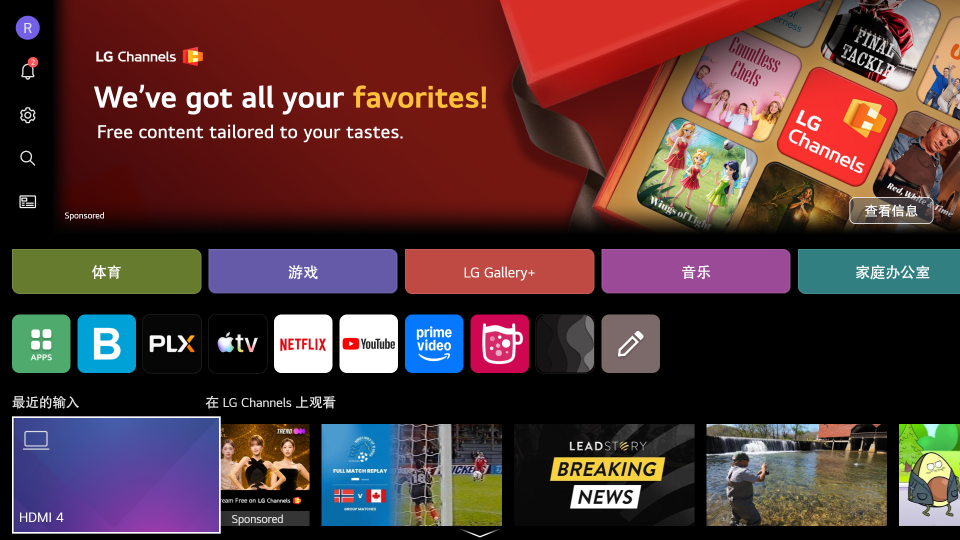
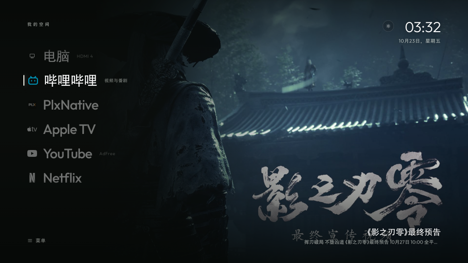

# LG webOS poster-list desktop

[简体中文](README.md) | **English**

A poster-list Chinese launcher for rooted LG webOS TVs. It takes over the remote Home button and restores the launcher or the last HDMI input after waking from standby. The launcher runs on the TV, so no computer has to stay on.

It starts from [webos-vibehack](https://github.com/OmkarK97/webos-vibehack), with Chinese font fallback, a TV-side button helper, the poster-list home, and standby recovery added here. Current source and tested version: **1.4.1**. The interface is in Chinese; this page is the English documentation.

## Install

The TV must be rooted, with Homebrew Channel installed and SSH key login configured. This repository does not provide root tools or third-party binaries. Follow [installation and deployment](docs/install.md) to sync apps, prepare native dependencies, and package the launcher. Disabling works from the same page.

A rooted TV installs over **root SSH on port 22**, not the webOS Developer Mode port 9922. After installation, press Home once to open the desktop.

## Interface

| LG stock home | Custom desktop |
|---|---|
| [](docs/images/lg-home.png) | [](docs/images/poster-home-1.4.1.png) |

The left side is a vertical list of the computer input and favourite apps. The focused app gets a dynamic cover:

- Landscape covers run full-bleed. Portrait covers sit in a card at about 80% height on the right, over a blurred and darkened copy of the same image.
- Covers crossfade with two layers. They do not slide sideways or stack when switching quickly.
- The bottom-right caption shows the current title and a one-line description, with Chinese preferred.
- The three-line menu at the bottom left holds all apps, inputs, network, and settings.
- Themes are auto, dark, and light. In light mode the clock and caption use a translucent paper surface.
- Wallpapers are a valley, misty mountains, or a solid color. The theme switches on local TV time at 07:00 and 19:00, or can be locked in settings.

Settings are grouped into **Appearance**, **Desktop**, and **System**. Appearance holds theme and wallpaper, Desktop holds home apps and content sources, and System opens LG settings. Theme, wallpaper, home apps, and order are stored on the TV, and upgrades inherit the previous settings.

The screenshots show layout only. Results for button interception and standby recovery are in the [verification record](docs/verification.md).

## Home button and standby behavior

| Action | Result |
|---|---|
| Short press Home | Open the custom desktop |
| Hold Home for about 1 second, then release | Open LG stock home |
| Shut down from the desktop, then power on (wake from standby) | Restore the custom desktop |
| Shut down from HDMI, then power on | LG keeps the last input |
| Exit an app launched from the desktop | Return to the desktop (verified with Bilibili) |
| Exit an app launched from LG stock home | Keep the stock return behavior |

Back-button behavior inside third-party apps is up to each app. YouTube AdFree and Alcyone show no exit confirmation at the top level, so a short Home press returns to the desktop. Leaving the Alcyone screen does not disconnect the VPN tunnel.

## Manage apps

1. Add or remove apps: open **All apps** from the menu, choose **Edit desktop**, then toggle apps. Hiding affects the home screen only; the all-apps list stays complete.
2. Reorder: in **Edit desktop**, choose **Adjust home order**. Move with the arrow keys, confirm to save, Back to cancel.
3. Refresh: reopen the desktop after installing an app, or refresh manually in the all-apps panel.

## Compatibility and known limitations

Tested on an LG OLED42C5XCA running webOS SDK 11.2.0 and firmware 43.21.73.

The kernel is aarch64, but input interception and the user-space dependencies run in an ARM32 environment. Do not choose aarch64 native modules from the kernel architecture.

Known limitations:

- Holding Home for more than 6 seconds is not handled yet.
- The TV-side button helper has no supervisor to restart it after a crash.
- Playback position inside third-party streaming apps is not restored.
- Standby recovery is verified on the TV; a full cold boot is not.
- The app graphics layer is capped at 1920×1080, and a 4K TV upscales the whole interface. Full-bleed landscape covers look softer than portrait cards on 4K; the public YouTube thumbnail is at most 1280×720.
- Covers come from public sources. If an old low-resolution image remains after an upgrade, force an update from **Settings → Content sources → Refresh public content**. Portrait cards and full-bleed covers use different source sizes.

## Dynamic cover sources

The TV fetches public data asynchronously to build covers and titles. It does not read personal accounts or watch history.

| Cover app | Source | Notes |
|---|---|---|
| Bilibili | [Bilibili public popular list](https://www.bilibili.com/v/popular/all) | Public ranking, no personal recommendations |
| YouTube | [NASA](https://www.youtube.com/@NASA) public RSS | Public video updates and thumbnails, up to 1280×720 |
| Netflix | [Netflix Tudum Top 10](https://www.netflix.com/tudum/top10) | Weekly English TV top 10, covers prefer [TVmaze](https://www.tvmaze.com/api) originals |
| Apple TV | [Apple TV Press](https://www.apple.com/tv-pr/originals/) + TMDB | Prefer TMDB originals; fall back to Apple's `video_show_home_large_2x` 1960×1104 / `large_2x` |
| Prime Video / Disney+ / HBO Max | [TMDB API](https://www.themoviedb.org/) + JustWatch | Public catalog picks for the US region, preferring `original` sizes |

TMDB covers show catalog picks, not official rankings or personal watch progress. Prime Video covers are confirmed on the TV. Disney+ and HBO Max have only been checked through data queries, with no playback test. Artwork and trademarks belong to their owners. TMDB setup is in [streaming catalog configuration](docs/streaming-catalog.md).

> This product uses the TMDB API but is not endorsed or certified by TMDB. Streaming availability data is provided by JustWatch via TMDB.

## Local development and checks

Local checks need Node.js 22 and Python 3.12, and do not connect to the TV:

```sh
node --test tests/*.cjs
python3 -m compileall -q tools scripts
bash -n scripts/build.sh service/autostart.sh
```

`app/apps.example.js` is a placeholder. Before the first deployment, run `tools/sync-apps.py` to sync the real app list and icons from the TV. Do not treat the example as the inventory on the device. The left-side **Computer** entry comes from `computerInput` in `app/config.js`, for example `com.webos.app.hdmi4`.

## Documentation

The linked guides are in Chinese:

- [Installation and deployment](docs/install.md)
- [Home interception and recovery](docs/architecture.md)
- [Native dependencies and checksums](docs/native.md)
- [Streaming catalog configuration](docs/streaming-catalog.md)
- [Verification record](docs/verification.md)
- [Project history](docs/project-record.md)
- [Changelog](CHANGELOG.md)

## Upstream and license

The frontend starts from webos-vibehack. The native dependencies are inputhookpp and ezinject; the remaining projects are design references or separately installed apps. The full list, licenses, and asset credits are in [upstream and credits](docs/credits.md).

New code and frontend changes are MIT. Upstream notices stay in [LICENSE](LICENSE) and the [original license file](licenses/webos-vibehack-MIT.txt). The Outfit font in `app/fonts/` is SIL OFL 1.1; `inputhookpp` and `ezinject` ship under their own licenses, outside MIT. This project is not affiliated with LG. Rooting may affect the warranty and cannot be guaranteed to be reversible without loss.
