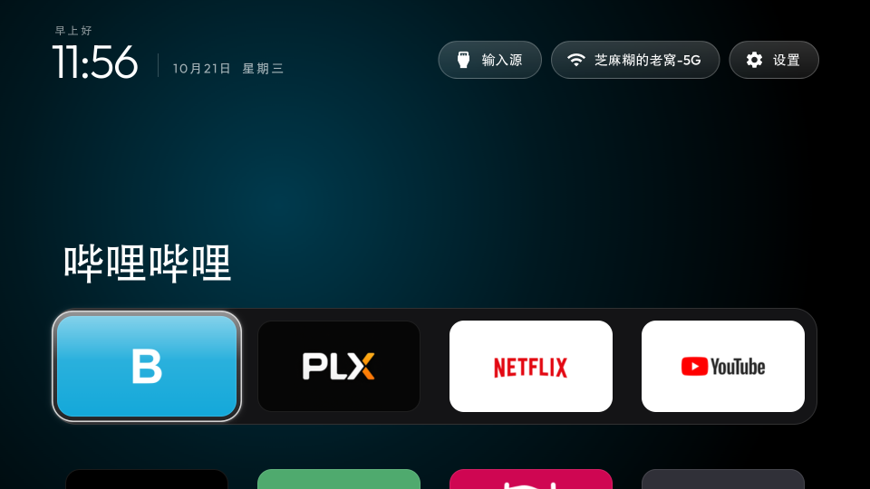

# LG webOS 中文桌面

为 LG webOS 电视提供 Apple TV 风格的中文桌面，并在已 root 的电视上接管 Home 键、记住关机前的新桌面或 HDMI 输入源。当前源码版本为 **1.0.8**。

本项目基于 [webos-vibehack](https://github.com/OmkarK97/webos-vibehack)，补充中文字体回退、电视端按键助手和界面恢复。不需要电脑常开。

## 界面对比

2026-10-21 在同一台 LG C5 上截取，项目桌面版本为 1.0.7。点击图片可查看原尺寸。

| LG 原厂首页 | 项目中文桌面 |
|---|---|
| [](docs/images/lg-home.png) | [](docs/images/custom-home.png) |

新桌面把时钟、常用应用和输入源入口放在首屏，不显示原厂首页的推荐内容。中文日期、问候语与菜单均来自当前界面，两张图均为原始实机截图。原厂首页仍可通过长按 Home 打开。

静态截图只展示布局。Home 无闪回与界面恢复的验证范围见 [验证记录](docs/verification.md)。

## 当前行为

| 操作 | 结果 |
|---|---|
| 短按实体遥控器 Home | 打开新桌面 |
| 长按 Home 约一秒后松开 | 打开 LG 原厂首页 |
| 在新桌面关机后开机 | 恢复新桌面 |
| 在 HDMI 关机后开机 | 由 LG 系统保留最近输入源 |
| 从新桌面打开应用后退出 | 返回新桌面；当前实机验证为哔哩哔哩 |
| 从 LG 原厂首页打开应用后退出 | 保留原厂返回行为 |
| 停用桌面改造 | 移除自定义启动钩子和按键租约，保留 root 与应用 |

中文使用 UTF-8，字体回退包含 LG 中文字体。日期、问候语、输入源和设置按钮已中文化。桌面空闲三分钟后降低亮度，不更改电视自身的 OLED 保护设置。

## 适用范围

已有实机记录：LG OLED42C5XCA，webOS SDK 11.2.0，固件 43.21.73。虽然内核是 aarch64，按键进程和用户空间依赖使用 ARM32；不能仅按内核架构选择模块。

本仓库不提供 root 工具或通用机型适配。安装前需要自行完成 root、Homebrew Channel 和密钥 SSH。原生依赖需要单独准备，仓库不附带第三方二进制或 IPK。

当前已知限制：超过六秒的 Home 长按未修正；桌面助手没有崩溃后自动重启监督；第三方视频应用的播放位置不在恢复范围内。新恢复逻辑尚无完整冷启动的实机验收记录。

## 使用文档

- [安装到已 root 的电视](docs/install.md)：同步应用、准备依赖、打包、安装和停用。
- [Home 接管与界面恢复原理](docs/architecture.md)：模块边界、状态和故障处理。
- [原生依赖来源](docs/native.md)：版本、校验值和准备方法。
- [本次改造记录](docs/project-record.md)：问题、迭代、pstack 审查及验证边界。
- [验证记录](docs/verification.md)：实机事实与本地检查分开记录。
- [版本变化](CHANGELOG.md)。

## 本地检查

需要 Node.js 22 和 Python 3.12。下面的检查不连接电视。

```sh
node --test tests/*.cjs
python3 -m compileall -q tools scripts
bash -n scripts/build.sh service/autostart.sh
```

仓库的 `app/apps.example.js` 默认只包含一个 LG 原厂首页示例。应用清单与图标由你在本地同步，不能把示例清单当作电视的实时应用列表。同步不会改变 dock 顺序；在 `app/config.js` 中指定要固定的应用 ID。

## 来源与许可

本项目的新增代码和前端改造使用 MIT 许可。上游版权声明保留在 [LICENSE](LICENSE) 和 [原始许可](licenses/webos-vibehack-MIT.txt)。Outfit 字体及其 OFL 许可保留在 `app/fonts/`。

原生 `inputhookpp` 与 `ezinject` 是独立外部依赖，适用各自许可，不能把它们统称为 MIT；版本和许可见 [原生依赖来源](docs/native.md)。本项目没有 LG 官方关联，也不承诺 root 可无痕撤销或不影响保修。
