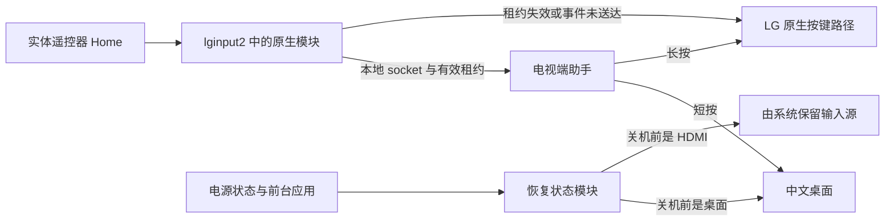

# Home 接管与界面恢复原理

第三方 webOS 应用能被安装和启动，但安装本身不会把它变成系统首页。因此，这次改造把桌面渲染与系统按键分开：前端负责界面，root 助手负责 Home 和界面恢复。

## 按键所有权

`service/native-home.js` 提供本地 UNIX socket，并每 400 毫秒更新租约。外部原生模块只在事件完整送达且租约未过期时接管 Home，否则放行 LG 原始路径。租约协议来自固定版本的 HomeBack 适配。

`service/service.js` 用按下和松开的时间区分短按与长按。短按打开 `com.gathin.tvhome`，约 650 毫秒及以上的长按打开原厂首页。现有六秒陈旧按键清理逻辑会让超过六秒的长按没有操作，这是已知限制。

启动脚本的 `flock` 防止重复启动助手。适配器遇到现有 socket 时，先检查是否存在活跃监听者；仅在确认连接失效、且文件身份未变时回收。未拥有连接的进程不能移除另一个监听者的租约。

助手还保留 evdev 回退。回退没有原生拦截能力，不能保证短按 Home 无原厂闪回。无闪回效果依赖原生模块成功加载与新鲜租约。

## 恢复操作的所有权

`service/resume-state.js` 记录前台应用，并每秒查询电源状态。它只主动恢复自己的桌面；HDMI 留给 LG 系统，其他已打开的内容应用不会被主动拉回桌面。

一次恢复操作拥有独立对象和六秒期限。休眠或超时会使该对象失效，旧的前台查询与启动回调不能再改变状态。电源查询也有独立请求身份，四秒超时后的旧回复会被忽略。

每个活动周期最多尝试恢复三次。三次失败后显示 `failed`，下一次非活动电源状态会重置尝试次数。这里没有进程崩溃后的自动重启监督。

## 当前界面与持久化界面

助手分开记录内存里的 `lastScreen` 和成功写入磁盘的 `persistedScreen`。保存先写临时文件，再 rename 替换。写入失败时保留 `persistencePending`，后续轮询重试，总共最多三次。

这避免了内存已经显示“保存成功”，磁盘却仍停在旧 HDMI 的情况。原子替换不等于断电耐久保证；实现没有对状态文件执行显式 fsync。

## 电脑的作用

电脑只用于配对、打包、安装和维护。按键、租约与界面恢复都在电视端运行。1.0.9 的 root 助手通过 listLaunchPoints 获取可启动应用，将本地图标转换为图片数据返回前端。桌面首次加载、再次打开或手动刷新时更新列表，读取失败则保留缓存和打包时清单。隐藏选择和排序分别保存在前端 localStorage 中。

## 应用退出后的返回来源

`service/return-origin.js` 在新桌面直接切入内容应用时记录来源。只有这个应用随后退出到 LG 首页，且电视仍为活动状态时，才打开新桌面。来源由前台转换推断，不改第三方应用；无关应用切换会取消记录。

主动长按 Home 会在打开原厂首页前取消记录，因此不会被新桌面立即拉回。原厂首页进入的应用没有新桌面来源，仍由系统处理退出。电源确认只在需要返回时请求，有 1.5 秒期限；失效回复不再启动桌面。此机制修正最终返回目标，不保证应用退出过渡没有原厂首页画面。

## 磁贴前端与设备接口

1.1.0 使用本地 HTML、CSS 和 JavaScript 渲染磁贴。`app/device.js` 管理 PalmServiceBridge 的请求、超时和回收。浏览器预览不执行设备操作。

`app/theme.js` 根据模式和本地小时计算主题，每十秒以及桌面恢复时刷新。手动模式不会被时钟覆盖。前端在 `tvhome.tiles.v1` 中保存首页应用、顺序、主题、壁纸和焦点，写入成功后才更新内存设置。旧版隐藏与排序键仅用于首次迁移。

应用列表来自 root 助手的 `listApps`，失败时保留本地缓存。VPN 状态通过助手的 `vpnStatus` 读取，此接口只允许桌面应用调用，固定查询 Alcyone 后只返回连接布尔值，不向前端提供节点或认证信息。没有安装 Alcyone 时，网络入口打开 LG 网络设置。

这版没有改动 `native-home.js`、`resume-state.js` 或 `return-origin.js`。
