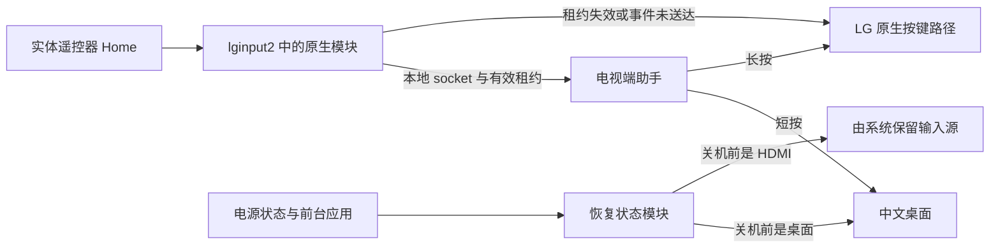

# Home 接管与界面恢复原理

第三方 webOS 应用能被安装和启动，但安装本身不会把它变成系统首页。因此，这次改造把桌面渲染与系统按键分开：前端负责界面，root 助手负责 Home 和界面恢复。

## 按键所有权

`service/native-home.js` 提供本地 UNIX socket，并每 400 毫秒更新租约。外部原生模块只在事件完整送达且租约未过期时接管 Home，否则放行 LG 原始路径。租约协议来自固定版本的 HomeBack 适配。

`service/service.js` 用按下和松开的时间区分短按与长按。短按打开 `com.gathin.tvhome`，约 650 毫秒及以上的长按打开原厂首页。现有六秒陈旧按键清理逻辑会让超过六秒的长按没有操作，这是已知限制。

启动脚本的 `flock` 防止重复启动助手。适配器遇到现有 socket 时，先检查是否存在活跃监听者；仅在确认连接失效、且文件身份未变时回收。未拥有连接的进程不能移除另一个监听者的租约。

助手还保留 evdev 回退。回退没有原生拦截能力，不能保证短按 Home 无原厂闪回。无闪回效果依赖原生模块成功加载与新鲜租约。

## 恢复操作的所有权

`service/resume-state.js` 记录前台应用，并每秒查询电源状态。它只主动恢复自己的桌面；HDMI 留给 LG 系统，其他已打开的内容应用不会被主动拉回桌面。

一次恢复操作拥有独立对象和六秒期限。休眠或超时会使该对象失效，旧的前台查询与启动回调不能再改变状态。电源查询也有独立请求身份，四秒超时后的旧回复会被忽略。

每个活动周期最多尝试恢复三次。三次失败后显示 `failed`，下一次非活动电源状态会重置尝试次数。这里没有进程崩溃后的自动重启监督。

## 当前界面与持久化界面

助手分开记录内存里的 `lastScreen` 和成功写入磁盘的 `persistedScreen`。保存先写临时文件，再 rename 替换。写入失败时保留 `persistencePending`，后续轮询重试，总共最多三次。

这避免了内存已经显示“保存成功”，磁盘却仍停在旧 HDMI 的情况。原子替换不等于断电耐久保证；实现没有对状态文件执行显式 fsync。

## 电脑的作用

电脑只用于配对、打包、安装和维护。按键、租约与界面恢复都在电视端运行。1.0.9 的 root 助手通过 listLaunchPoints 获取可启动应用，将本地图标转换为图片数据返回前端。桌面首次加载、再次打开或手动刷新时更新列表，读取失败则保留缓存和打包时清单。隐藏选择和排序分别保存在前端 localStorage 中。

## 1.5.0 系统 Home

系统 Home 模式把已安装的桌面复制到内存，修改副本的 `appid` 为 `com.webos.app.home`，再用 bind mount 覆盖 LG 原厂 Home 目录，重启应用管理器 `sam`。这样 webOS 原本要打开原厂 Home 的所有路径都会打开桌面，应用退出不再需要事后拉回，也不会先显示原厂 Home。

`service/as-home.sh` 只在 `/media/developer/apps/.../com.gathin.tvhome` 存在时工作；它同时隐藏普通桌面入口、恢复原 Home 键位、删除旧的原生 Home 标记、创建 `/var/lib/lg-c5-home/system-home`、重启 `sam`、启动桌面服务，并设置启动输入。所有改动都在内存挂载和 `/var/lib/lg-c5-home` 中，LG 原厂 Home 文件不变。

系统 Home 副本和普通应用使用同一个内容缓存目录，并允许两者调用 `publicContent`、`vpnStatus` 和 `app-state`。`service/app-state.js` 保存首页应用、顺序、主题、背景和最后焦点；安装时普通应用先启动一次把旧 localStorage 写入状态文件，Home 副本首次启动读取它。

`service/service.js` 在系统 Home 模式下让 Home 键走 webOS 原生路径，不再启动旧助手。返回键事件仍被非阻塞读取：短按不处理，长按约 650 毫秒且前台是内容应用时，启动系统 Home。`return-origin` 在该模式下停用，`resume-state` 的桌面目标改为 `com.webos.app.home`。

`tools/desktop_mode.py off` 卸载系统 Home 和屏保的 bind mount、移除启动钩子、恢复键位并重启 `sam`，然后打开原厂 Home；`on` 重新执行两个挂载脚本。

## 1.5.3 系统屏保

1.5.2 的屏保是 launcher 内的覆盖层，和 LG 系统屏保都以 3 分钟为阈值；系统屏保窗口在 launcher 之上，所以用户实际看到的是原厂时钟。1.5.3 改为和系统 Home 相同的替换方式，但对象是 `com.webos.app.screensaver`。

独立页位于 `service/screensaver-app`，是一个 `type: web`、`defaultWindowType: screenSaver` 的 appinfo 和纯黑时钟页。`service/screensaver-as-system.sh` 把它复制到 `/var/lib/lg-c5-home/screensaver`，bind mount 到原厂屏保目录，重启 `sam`，并在 `/var/lib/webosbrew/init.d/41-gathin-screensaver` 注册启动钩子。原厂 Flutter 文件不写入、不删除；卸载挂载即恢复。

屏保页的时钟每秒更新，整组时钟每 25 秒随机位移。它不再把按键完全交给系统：收到任意按键、鼠标按下或滚轮后，先调用电视端服务的受限 `closeApp` 关闭 `com.webos.app.screensaver`；如果服务不可用，再尝试 `window.close()`。`closeApp` 接受屏保、普通桌面、系统 Home 三个 sender，以及没有 sender 的 root 维护工具，避免成为任意第三方应用的通用关闭接口。

安装器在停止助手前先请求关闭正在运行的屏保，避免 `as-home.sh` 的 `systemctl restart sam` 被屏保前台阻塞；安装完成后再关闭一次并重新挂载屏保。`screensaver_mode.py off/on` 单独恢复或重新启用屏保，`desktop_mode.py off` 同时处理 Home 和屏保。

公开封面服务仍然每 5 分钟检查。YouTube RSS、Netflix Tudum 和 TMDB 在受限网络下会超时或 403，服务保留上次封面并将错误写入内容来源状态；B 站和 Apple TV 通常可直连。1.5.3 读取 `/var/lib/alcyone-singbox/core-config.json` 中的 loopback SOCKS 入站端口，对 YouTube（含 `ytimg.com` 缩略图）、Netflix、TMDB 使用 SOCKS5 代理，其他公开源直连；服务不读取 Alcyone 的出站节点或凭据。代理不可用时请求失败，缓存保留。

## 旧版 Home 接管与返回来源

1.4.x 及以前的模式使用 `service/return-origin.js`：在新桌面直接切入内容应用时记录来源，应用退出到 LG 首页后再打开新桌面。来源由前台转换推断，不改第三方应用；无关应用切换会取消记录。该机制只能修正最终目标，不能保证退出过渡没有原厂首页画面；系统 Home 模式不再使用它。

主动长按 Home 会在打开原厂首页前取消记录，因此不会被新桌面立即拉回。原厂首页进入的应用没有新桌面来源，仍由系统处理退出。电源确认只在需要返回时请求，有 1.5 秒期限；失效回复不再启动桌面。此机制修正最终返回目标，不保证应用退出过渡没有原厂首页画面。

## 磁贴前端与设备接口

1.1.0 使用本地 HTML、CSS 和 JavaScript 渲染磁贴。`app/device.js` 管理 PalmServiceBridge 的请求、超时和回收。浏览器预览不执行设备操作。

`app/theme.js` 根据模式和本地小时计算主题，每十秒以及桌面恢复时刷新。手动模式不会被时钟覆盖。前端在 `tvhome.tiles.v1` 中保存首页应用、顺序、主题、壁纸和焦点，写入成功后才更新内存设置。旧版隐藏与排序键仅用于首次迁移。

应用列表来自 root 助手的 `listApps`，失败时保留本地缓存。VPN 状态通过助手的 `vpnStatus` 读取，此接口只允许桌面应用调用，固定查询 Alcyone 后只返回连接布尔值，不向前端提供节点或认证信息。没有安装 Alcyone 时，网络入口打开 LG 网络设置。

这版没有改动 `native-home.js`、`resume-state.js` 或 `return-origin.js`。

## 动态内容与自动配色

1.2.0 的 `app/palette.js` 把图标缩小到 32×32 像素后统计彩色像素，忽略透明、近黑与近白像素。主色用于生成深浅两套低饱和底色与文字色，主题切换无需重新读取图标。无有效主色时使用应用声明色，无法读取时回退中性色。取色在内存中缓存，不保存图标到外部服务。

`service/public-content.js` 通过 `publicContent` 提供内容，只接受桌面应用调用。来源与图片域名固定在代码中，HTTPS 请求有超时和大小限制，不接受前端指定任意 URL。1.5.1 起服务端每 5 分钟检查一次，公开来源缓存 15 分钟，TMDB 片库缓存 30 分钟；应用每 60 秒读取结果。前端获得的图片是应用目录内的缓存相对路径。1.5.1 起公开来源按 15 分钟、TMDB 片库按 30 分钟缓存，服务每 5 分钟检查；失败保留原内容与原时间，重试至少间隔五分钟；未被当前内容引用的旧图片在一天后清理。

B站使用公开热门接口，YouTube 使用 NASA RSS，Netflix 使用官方周榜并匹配 TVmaze 封面，Apple TV 使用官方公开片单。这些公开目录不代表个人推荐、播放历史或本地区完整片库。网页端点可能变化，首次获取失败时保留应用图标。TVmaze 归属入口位于内容来源面板，素材权利见 `app/ASSETS.md`。

## 1.5.4 内容来源、输入标签与 HDMI 退出

“内容来源”由 `app/content.js` 和 `app/sources.css` 组成。服务提供来源的 `status`、`fetchedAt`、`items` 和 `error`；前端把它们映射为已更新、缓存、刷新失败、未配置和正在获取。来源行只读，刷新按钮和署名按钮保留键盘焦点；错误行显示服务返回的失败原因。没有把来源行做成假按钮，也没有把署名塞进卡片。

输入源标签的自动部分只覆盖配置中的电脑输入：`deviceInfo(computer)` 在没有显式覆盖时返回电脑预设，首页、输入源面板和标签面板共用同一个名称与桌面图标。其他 HDMI 端口没有可靠的设备类型接口，仍由用户循环选择预设，避免根据品牌或端口号猜测设备。

系统 Home 模式下，`handleHome` 对短按 Home 再检查前台：前台不是系统 Home 时显式启动已挂载的 Home，解决 HDMI 输入中 Home 无反应。`handleBack` 对 HDMI/直播输入允许短按返回桌面；内容应用中的短按仍完全交给应用，长按约 650 毫秒才由服务接管。短按路径通过前台查询和 `enabled` 检查，避免停用后仍然启动。
